# Inventory Optimisation – Final Report

*Divya Shori · Data-driven Supply Chain Management & Logistics · Group 2 · HSLU · November 2026*  
*Code and notebooks: [github.com/divyashori-datascience/group2-topic1-scm-inventory-optimisation](https://github.com/divyashori-datascience/group2-topic1-scm-inventory-optimisation)*

**Presentation:** [presentation/Inventory_Optimisation_Final_Presentation.pdf](presentation/Inventory_Optimisation_Final_Presentation.pdf)

## Executive summary

The company can release about 1.27M of tied-up capital (−26% vs 2021) while raising availability to 95% fill, by stocking only the right articles and setting their reorder points from demand every month.

Capital lockup rose from 16% of revenue (2019) to 27% (2022). We analysed 2.69M stock movements (2007–2022, 58,764 articles) in three steps that build on each other:

| Step | Question | Answer |
| --- | --- | --- |
| 1 · Data analysis | Where does the capital sit and how healthy is it? | Stock in inventory articles +39% since 2018; 37% of stock value has no reorder point; 0.94M idle for over a year |
| 2 · Classification | Which articles belong on stock? | Four classes; Runners (10% of active articles, 74% of usage) go on stock, Repeaters selectively, One-offs and Dormant articles do not |
| 3 · Reorder points | At what level should each stock article reorder? | Demand-driven levels, recalculated monthly: 95% fill (97% on A-articles) with 26% less capital than 2021 |

**Recommended strategy:** clean the range (de-list 427 stock articles, run down idle stock), stock by class, and replace manual reorder points with demand-driven ones recalculated every month, starting with the A-articles that hold about 65% of capital. All values are in the dataset's anonymised currency units at current purchase price.

## 1 · Data and cleaning approach

Every number in this report comes from a daily stock history we rebuilt per article from 2.69M movements, after a data audit found four issues that would otherwise distort capital and demand.

### The data at a glance

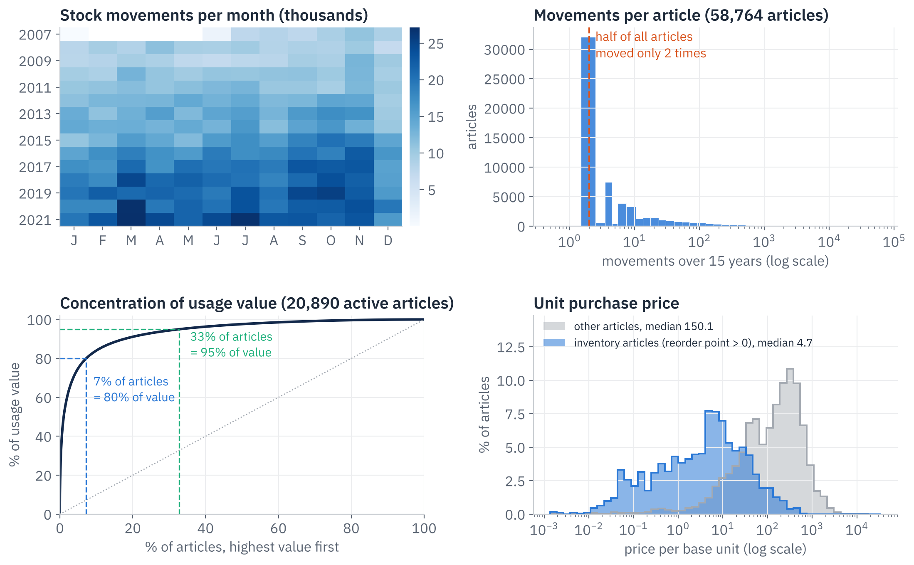

- **Activity grew about five-fold:** 108k movements in 2008, 274k in 2021. Rules set years ago are unlikely to fit today.
- **A very long tail:** half of all 58,764 articles moved only twice in fifteen years (typically one receipt, one use).
- **Value is concentrated:** 7% of the active articles carry 80% of usage value, 33% carry 95%. This is the basis for the ABC service levels in section 6.
- **Stock articles are cheap, high-volume parts:** median unit price 4.7 for articles with a reorder point, 150 for the rest.

### Preparation pipeline

| Step | Count | What happens |
| --- | --- | --- |
| Raw movements | 2,694,849 | 17 attributes, 2007–2022, no missing values |
| Stock rebuilt | 160 levels repaired | stock = opening level + cumulative movements |
| Demand movements | 2.18M | sales (1) + production use (5), returns netted |
| Daily table | 58,764 articles × 5,480 days | stock and demand per article and day |
| Active articles | 20,890 | demand in the last three years → Part 2 |
| Inventory articles | 1,751 | reorder point > 0 → Part 3 |

**Dataset:** 2,694,849 transactions, 17 attributes, 58,764 articles, 21.01.2007 – 21.01.2022, no missing values. 1,751 articles carry a safety stock above zero; the company uses that field as the **reorder point**.

| Audit finding | Evidence | What we did |
| --- | --- | --- |
| `inventory_level` is the stock **before** each movement, not after as documented | 99.99% of rows satisfy next level = level + quantity | Rebuilt stock as opening level + cumulative movements |
| Corrupted rows | 160 rows inconsistent with the movement history; one shows 1.1 bn units | Removed automatically by the rebuild |
| Quantities are anonymised | 100% of quantities are integer multiples of 1.1107; safety stock and MOQ scaled the same way | Kept as delivered; ratios between quantity fields stay valid |
| Master data is a 2022 snapshot | Safety stock, lead time, MOQ, price never change within an article | History valued at today's price, compared with today's settings |

**Demand definition:** net sales (type 1) plus usage for production (type 5). Returns are netted out (3% of sales rows are positive, 28% of procurement rows negative). Internal transfers (4) and adjustments (2, 3) are not demand.

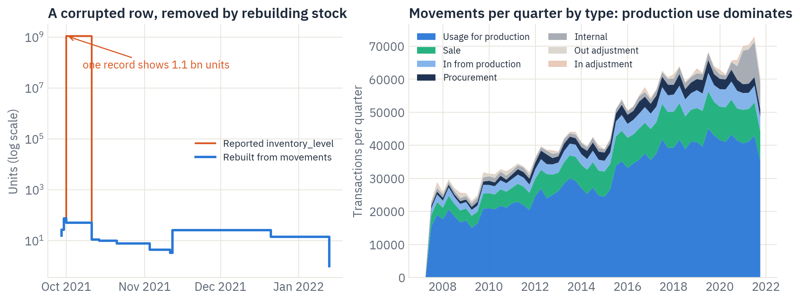

The left panel shows why rebuilding matters: one corrupted record would put a single cheap article at 1.1 bn units and inflate 2021 capital from about 8M to almost 2.9 bn. The right panel shows what the business is: 65% of all movements are usage for production, so most stock feeds the company's own production, not retail sales.

## 2 · What the data tells us

Capital is growing faster than demand, a large part of it is not managed by any rule, and the rules that exist do not fit the demand they face.

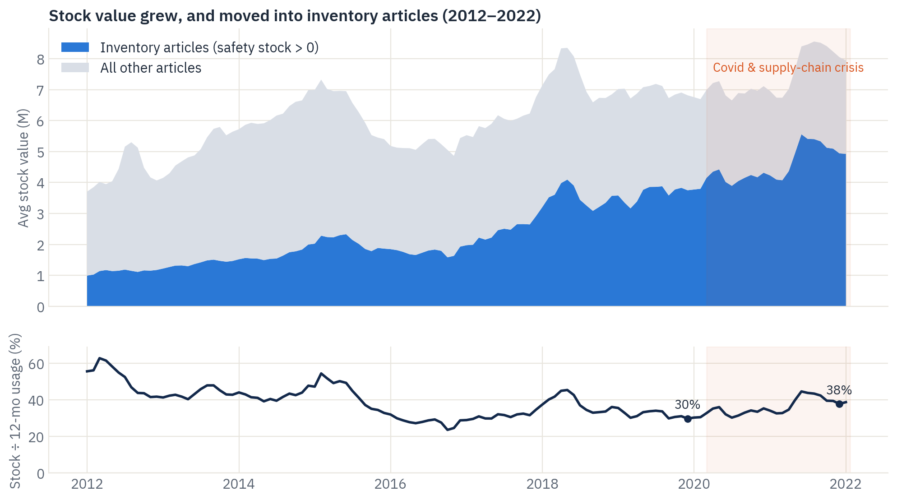

- **Capital moved into inventory articles.** Their stock value rose from 3.5M (2018) to 4.9M (2021), **+39%**, and their share of all stock from 48% to 62%. Stock grew faster than usage: from 30% to 38% of a year's usage.
- **37% of stock value (2.9M of 7.9M) sits in articles without a reorder point.** That is leftover or speculative stock no replenishment rule controls, a key input for the classification.

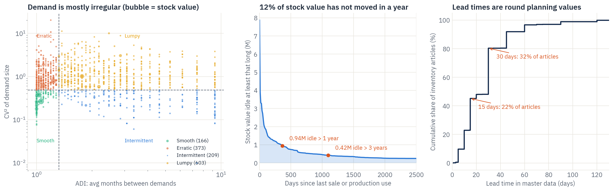

- **Demand is mostly irregular.** Only 166 inventory articles (about 10%) have smooth demand; the rest are erratic, lumpy, intermittent or sporadic, the case's *searched demand*. On 5% of demand days, rare large orders carry 29% of volume. One textbook safety-stock formula cannot fit all articles.
- **12% of stock value (0.94M) has not moved for a year**, 0.42M of it for three years or more. 318 inventory articles keep a reorder point despite no demand for over a year.
- **Lead times are manual planning values.** They are maintained for 98% of inventory articles, but 54% sit on exactly 15 or 30 days. There are no order dates, so the real lead time and its variability cannot be measured.

**What this means for the study:** the classification must decide which articles deserve stock at all (Part 2), and reorder points must follow each article's own demand pattern, separate rare large orders and be tested for lead-time errors (Part 3).

## 3 · Classification approach

**Three classifications, three decisions.** One grouping cannot answer three different questions, so the project uses three, each for one decision:

| Classification | Question | Based on | Groups | Used for |
| --- | --- | --- | --- | --- |
| Clusters (Part 2) | Should the article be on stock at all? | demand behaviour, K-means | Runners, Repeaters, One-offs, Dormant | stock, stock selectively, buy to order, phase out |
| Demand pattern (Part 3) | Which reorder-point formula fits? | ADI and CV² (Syntetos–Boylan) | Smooth, Erratic, Intermittent, Lumpy, Sporadic | normal formula vs empirical lead-time quantile |
| ABC (Part 3) | How much safety buffer? | 12-month usage value, cut at 80% / 95% | A, B, C | fill target 98% / 95% / 90% |

In one line: the cluster decides *if* we stock an article, the demand pattern *how* we compute its reorder point, ABC *how safely*.

We classified all 20,890 articles with demand in the last three years using K-means on four demand features; it beat two alternative algorithms on every quality metric and is highly stable.

**Population.** Every article with at least one sale or production use between 22.01.2019 and 21.01.2022, stocked or not, because the question is *which* articles should be on stock. Of these, 1,499 are stocked today.

**Feature selection (12 → 10 → 4).**

1. Twelve candidate features describe value, frequency, variability, recency, price, lead time, trend, product type, e-shop and age.
2. A redundancy filter drops one of every pair with Spearman |ρ| > 0.85: demand lines and weekly CV go. Order-size variability (cv²) is kept: its ρ = 0.90 with frequency is an artefact of one-time demand (cv² = 0 by definition) and falls to 0.49 for articles with three or more demand weeks.
3. A domain screen keeps four features: price is already inside usage value, lead time leaks today's stocking decision, product type, e-shop and age only profile the classes, and trend is noisy for low-volume articles.

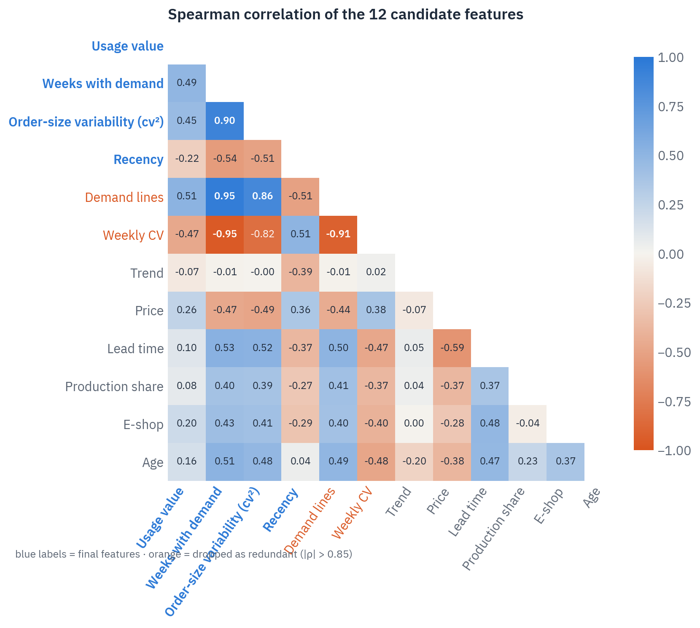

**Final features:** annual usage value (log), weeks with demand (log), order-size variability cv² (log), days since last demand; all standardised.

| Feature | Definition | Why it matters for stocking |
| --- | --- | --- |
| Usage value | units used per year × purchase price | how much money flows through the article |
| Weeks with demand | weeks with any demand, of 157 | how regularly it is needed |
| Order-size variability | CV² of non-zero order sizes | how predictable each order is |
| Recency | days since last demand | whether the article is still alive |

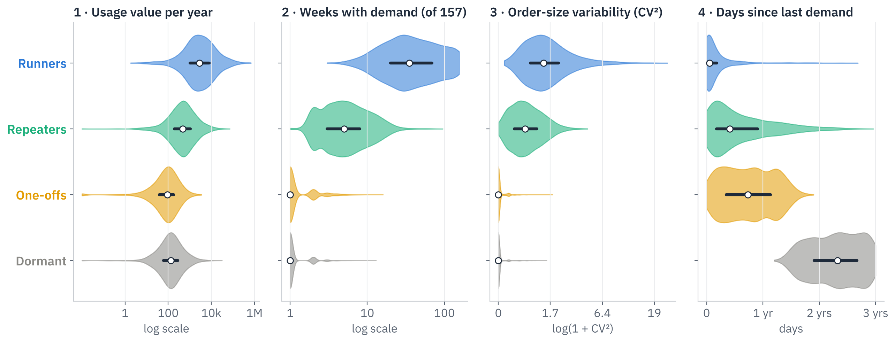

Each class has a clear fingerprint: weeks with demand separates Runners and Repeaters from the rest, recency separates One-offs from Dormant articles.

**Algorithm, number of classes and validation.**

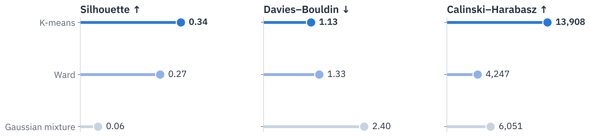

| Check | Result |
| --- | --- |
| K-means, k = 4 | Silhouette 0.34 · Davies–Bouldin 1.13 · Calinski–Harabasz 13,908 |
| Agglomerative (Ward), k = 4 | 0.27 · 1.33 · 4,247 (8,000-article sample) |
| Gaussian mixture, k = 4 | 0.06 · 2.40 · 6,051 |
| Choice of k | k = 3 scores marginally higher (0.35) but merges frequent and occasional articles that need different strategies |
| Stability | Bootstrap adjusted Rand index 0.98 (min 0.96) over 20 refits |
| Benchmark | Classic XYZ puts 98% of articles in "Z", so ABC-XYZ cannot separate this range |
| What separates the classes | Random forest, permutation importance: recency > variability > usage value > frequency |

Pure silhouette maximisation was tested and rejected: it kept the binary e-shop flag and dropped usage value, giving clusters that are statistically tidy but useless for stocking.

## 4 · The clusters, visualised

The four classes separate along two clear directions: how often and how much an article is used (left to right), and how long it has been idle (bottom to top).

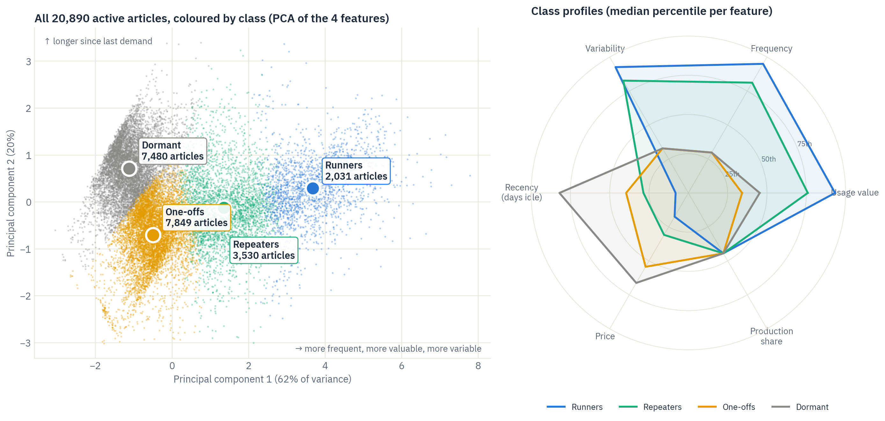

The first principal component (62% of variance) runs from rarely used, low-value articles to frequent, high-value, variable ones; the second (20%) is recency. Runners sit far right, Dormant articles top left, One-offs bottom left, and Repeaters in between. The radar shows that the classes also differ on features the model never saw: Dormant and One-off articles are the most expensive per unit, while Runners are cheap and often used in production.

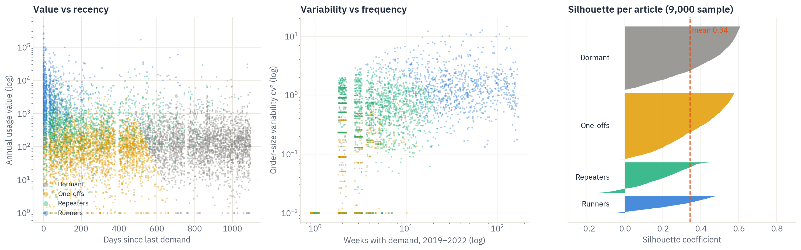

- **Value vs recency:** Runners cluster at recent, high-value demand; Dormant articles start where demand stopped about 14 months ago.
- **Variability vs frequency:** One-offs and Dormant articles have one or two orders (variability 0); Repeaters order a few times a year with variable sizes; Runners order weekly.
- **Silhouette:** mean 0.34. Dormant (0.41) and One-offs (0.37) are the cleanest classes; Repeaters (0.19) are the transition zone between occasional and regular demand, which is why their strategy is "selective".

## 5 · The four classes and their strategies

Only Runners, plus a selected part of the Repeaters, belong on stock; One-offs are bought to order and Dormant articles are phased out.

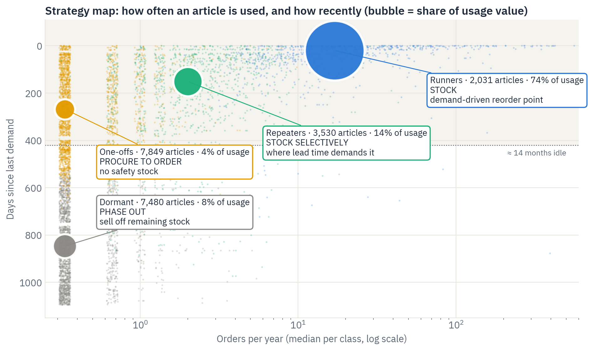

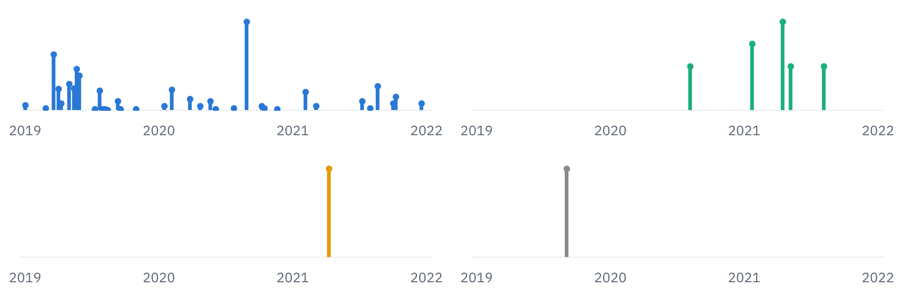

*Weekly demand of one typical article per class, 2019–2022:* the Runner is ordered almost every few weeks, the Repeater a handful of times, the One-off and the Dormant article once. The strategy follows from that rhythm: a buffer pays off only where demand comes often enough to turn it over.

| Class | Articles | Usage value | Stock value | Profile | Strategy | On stock? | Stocked today |
| --- | --- | --- | --- | --- | --- | --- | --- |
| **Runners** | 2,031 (10%) | 74% | 79% | ~17 orders a year, last used ~3 weeks ago, cheap, 37% production use | Stock with a demand-driven reorder point (section 6), service target by value | Yes | 979 |
| **Repeaters** | 3,530 (17%) | 14% | 14% | ~2 orders a year, lumpy sizes, last used ~5 months ago | Stock only where the supplier lead time is longer than customers will wait; otherwise to order | Selective | 345 |
| **One-offs** | 7,849 (38%) | 4% | 5% | one order in three years, expensive per unit, last used ~9 months ago | Procure or produce to order; no safety stock | No | 153 |
| **Dormant** | 7,480 (36%) | 8% | 2% | one order, no demand for 14+ months (median 2.3 years) | Phase out: stop replenishing, sell off or write down remaining stock | No | 22 |

Stock value = average 2021 stock of the 20,890 active articles (7.45M). Usage value = annual usage, 2019–2022.

**What changes for the client**

- **De-list 427 stock articles:** 175 stocked One-offs and Dormant articles plus 252 stocked articles without any demand in three years.
- **Review 1,052 Runners without a reorder point.** Only 18% of them are mainly used in production, so most are candidates for proper stock management rather than ad-hoc buying.
- **Repeaters need a rule, not a default:** keep stock where the lead time exceeds the delivery time customers accept, with a lower service target (about 90%).
- **The class becomes master data:** recompute it every quarter, so articles that slow down move from Runners to Repeaters to Dormant automatically.

## 6 · Reorder points and safety stock: why we simulated, and what it showed

A daily simulation of 2021 shows the demand-driven policy reaches 95% fill with 3.65M of average stock, against 4.92M actually held, and needs 34% less capital than today's reorder points at the same service.

### Service levels: what A, B and C mean

Part 3 uses a second, separate segmentation. The Part 2 classes (Runners, Repeaters, One-offs, Dormant) decide **whether** an article belongs on stock, based on its demand behaviour. The ABC classes decide **how much safety buffer** a stocked article gets, based on its value.

ABC is the classic Pareto cut: rank the 1,751 inventory articles by annual usage value (12-month usage × purchase price), add up their shares, and cut at 80% and 95%.

| Class | Share of usage value | Articles | Fill-rate target |
| --- | --- | --- | --- |
| **A** | top 80% | 167 (10%) | 98% |
| **B** | next 15% | 273 (16%) | 95% |
| **C** | last 5%, plus articles without usage | 1,311 (75%) | 90% |

A-articles hold about 65% of stock capital and a stockout there costs most, so they get the highest target and the pilot. C-articles are many but cheap, so a lower target saves capital at little risk. In the simulation, the safety parameter is calibrated per class so that each class just reaches its target. In one line: Part 2 decides *if* an article is stocked, ABC decides *how safely*.

### Why simulation

- **A formula alone cannot be trusted here.** 75% of inventory articles have irregular demand, orders are large and the minimum order quantity binds, so textbook formulas give levels whose real effect is unknown.
- **History cannot be replayed directly.** Planners overrode the reorder points by hand, and recorded service is censored: usage is only booked when stock exists, so the actual 99.6% fill says little.
- **The client needs proof before changing 1,751 settings.** A simulation tests every policy on the same real demand, with the same lead times and order sizes, on a year the method never saw.

### How the simulator works

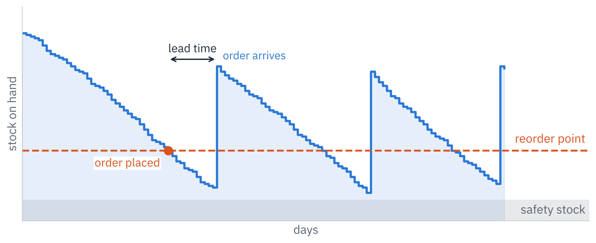

1. Every day, for all 1,751 inventory articles in parallel, base demand from 2021 is taken from stock; unmet demand is back-ordered.
2. When stock plus open orders falls to the reorder point, an order of today's typical size (at least the MOQ) is placed; it arrives after the article's lead time.
3. Rare large orders (daily demand above Q3 + 3·IQR, 5% of demand days, 29% of volume) are procured to order and not drawn from stock.
4. The demand-driven policy recalculates each reorder point monthly on the last 365 days: `μ·LT + z·σ·√(LT/7)` for steady demand, the p-quantile of past lead-time demand for irregular demand. Safety stock = reorder point − μ·LT.
5. Timeline without look-ahead: parameters from 2019–20, service level calibrated on 2020, results measured on 2021.

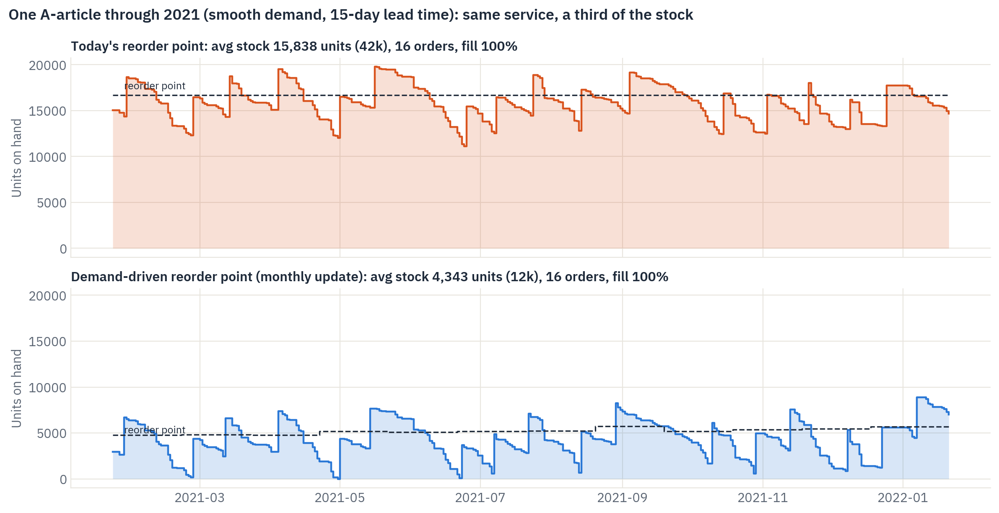

The example makes the mechanism visible. Today's reorder point (16,661 units) is 3.2 times what this article needs, so it carries about 15,800 units on average. The demand-driven point follows demand month by month and carries about 4,300 units with the same 16 orders and 100% fill: 72% less capital on this one article.

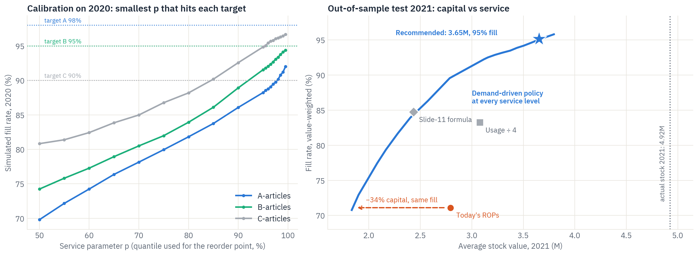

**What it showed**

| Policy (2021, same simulator) | Avg stock | Fill rate | Fill A-articles |
| --- | --- | --- | --- |
| Actual 2021 (observed) | 4.92M | – | – |
| Today's reorder points | 2.79M | 71% | 68% |
| Rule: usage 12 months ÷ 4 | 3.08M | 83% | 83% |
| Case slide-11 formula | 2.43M | 85% | 86% |
| **Demand-driven, monthly update** | **3.65M** | **95%** | **97%** |

- **Calibration:** C-articles reach their 90% target at p = 85%. A and B reach the best attainable level (92% and 94% in 2020) at p = 99.5%; the gap comes from new, fast-growing articles that no history can anticipate.
- **Today's reorder points, followed strictly, would give only 71% fill**, which is why planners top up by hand and stock ended at 4.9M.

### Stress test of the recommended strategy

A recommendation must survive bad lead times and demand shocks, so we re-ran the 2021 simulation under eight scenarios. Demand shocks are applied to 2021 only; the policy keeps recalculating its reorder points monthly.

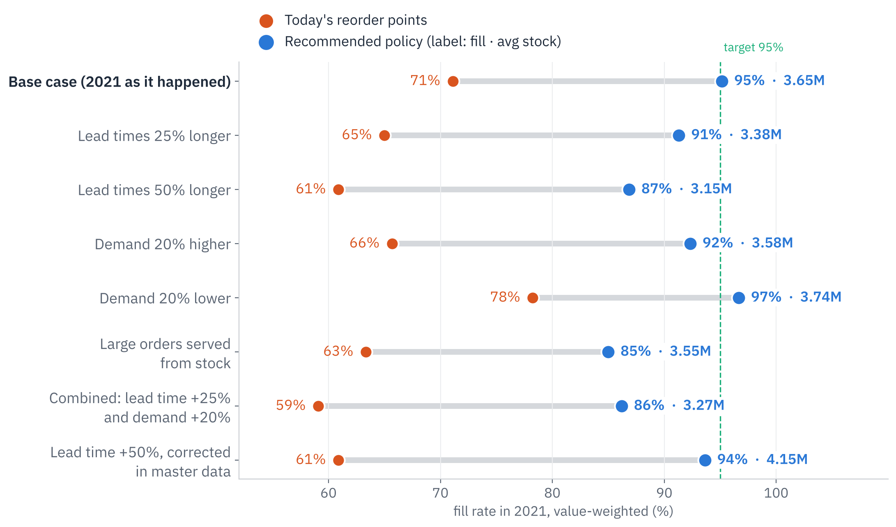

| Scenario | Today's reorder points | Recommended: fill | Recommended: avg stock |
| --- | --- | --- | --- |
| Base case (2021 as it happened) | 71% | **95%** | 3.65M |
| Lead times 25% longer | 65% | 91% | 3.38M |
| Lead times 50% longer | 61% | 87% | 3.15M |
| Demand 20% higher | 66% | 92% | 3.58M |
| Demand 20% lower | 78% | 97% | 3.74M |
| Large orders served from stock | 63% | 85% | 3.55M |
| Lead time +25% and demand +20% | 59% | 86% | 3.27M |
| Lead time +50%, corrected in master data | 61% | 94% | 4.15M |

- The recommended policy **never falls below 85% fill** and stays **18 to 33 points ahead** of today's reorder points, which never reach 80%.
- **Lead times are the main risk.** If real lead times are 50% longer and nobody notices, fill drops to 87%; once corrected in the master data, the policy recovers to 94% at 4.15M, still below the 4.92M actually held.

### What the simulation gave us

| | |
| --- | --- |
| **Exposed today's rules** | followed strictly, today's reorder points deliver only 71% fill |
| **Set the service levels** | targets per ABC class reached at the least capital, chosen on 2020 data |
| **Priced the impact** | on 2021, a year the method never saw: −1.27M (−26%) at 95% fill |
| **Tested the risks** | eight stress scenarios, lead times are the data to fix first |

**How it helps the client:** one tested rule replaces 1,751 manual settings; management can pick any point on the capital–service curve and know its cost in advance; and the stress tests show exactly which data (lead times) and processes (large orders) protect the result.

## 7 · The strategy we recommend

Stock the right articles, at levels set by demand: clean the range, decide stocking by class, and let a monthly demand-driven rule set every reorder point and safety stock.

1. **Clean the range (months 1–2).** De-list 427 stock articles (One-offs, Dormant, no demand in three years); stop replenishing them and sell off or write down 0.94M of stock idle for over a year.
2. **Stock by class (months 1–3).** Runners on stock; Repeaters only where the supplier lead time is longer than customers will wait; One-offs procured to order; Dormant phased out. Review the 1,052 Runners without a reorder point. Recompute the classes every quarter.
3. **Set levels from demand (months 2–6).** Replace manual reorder points with the demand-driven rule, recalculated monthly, with service targets A 98% / B 95% / C 90%. Start with the A-articles (about 10% of articles, 65% of capital) as a pilot, compare with the simulation, then roll out. Every article's recommended level is in `Part3_ROP_SafetyStock_Recommendations.xlsx`.
4. **Protect the result (ongoing).** Record order and receipt dates to measure real lead times (a 50% error costs 8 points of fill); plan rare large orders through customer and production orders, not stock; set order size and reorder point together, since order size is the strongest driver of the right level.

**Roadmap**

| Step | M1 | M2 | M3 | M4 | M5 | M6 |
| --- | :-: | :-: | :-: | :-: | :-: | :-: |
| 1 · Clean the range | ■ | ■ | | | | |
| 2 · Stock by class | ■ | ■ | ■ | | | |
| 3 · Levels from demand (A-article pilot first) | | ■ | ■ | ■ | ■ | ■ |
| 4 · Protect the result | ┄ | ┄ | ┄ | ┄ | ┄ | ┄ |

**Expected impact**

| Measure | Today | With the strategy |
| --- | --- | --- |
| Average stock, inventory articles | 4.92M (2021) | 3.65M (−1.27M, −26%) |
| Fill rate, value-weighted | 71% if today's reorder points were followed | 95% (A-articles 97%) |
| Holding cost (20% p.a., assumed) | – | about 0.25M a year saved (0.19–0.32M at 15–25%) |
| Idle stock to clear | 0.94M idle > 1 year | sold off or written down once |
| Reorder points to maintain by hand | 1,751 | 0: one rule, recalculated monthly |

## 8 · Limitations and next steps

The results are robust to the main data gaps, but three assumptions should be validated with the client before roll-out.

- **Master data is a 2022 snapshot.** History is valued at today's purchase price and compared with today's settings.
- **No order dates,** so lead-time variability cannot be measured; the stress test (+50% lead time → 87% fill) bounds the risk.
- **Holding cost rate (20%) is an assumption.** Capital figures do not depend on it; only the yearly saving does.
- **Censored service history:** the recorded 99.6% fill reflects usage booked only when stock exists, so service is compared inside the simulation, not against history.
- **Values are anonymised:** quantities carry a constant factor (×1.1107) and money is in dataset currency units; ratios and percentages are unaffected.

**Next steps:** agree service targets per class with the client, validate lead times for the A-articles, run the A-article pilot for one quarter, and quantify the capital released by phasing out One-offs and Dormant articles.

**Reproducibility:** all analysis runs from the raw file in the project repository [github.com/divyashori-datascience/group2-topic1-scm-inventory-optimisation](https://github.com/divyashori-datascience/group2-topic1-scm-inventory-optimisation): `shared/prep.py` for cleaning, then `part1_data_analysis`, `part2_article_classification` and `part3_safety_stock_rop`, each with its own README and notebooks.
